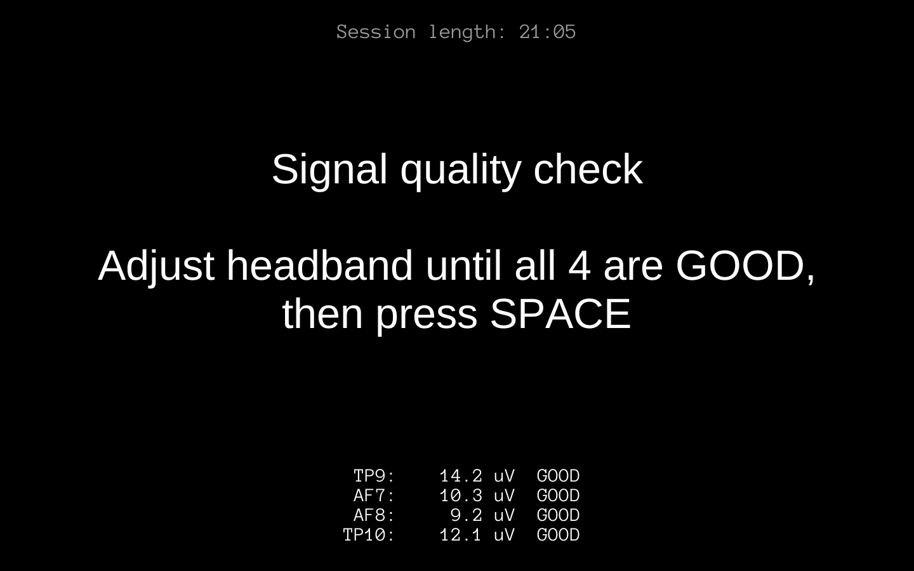
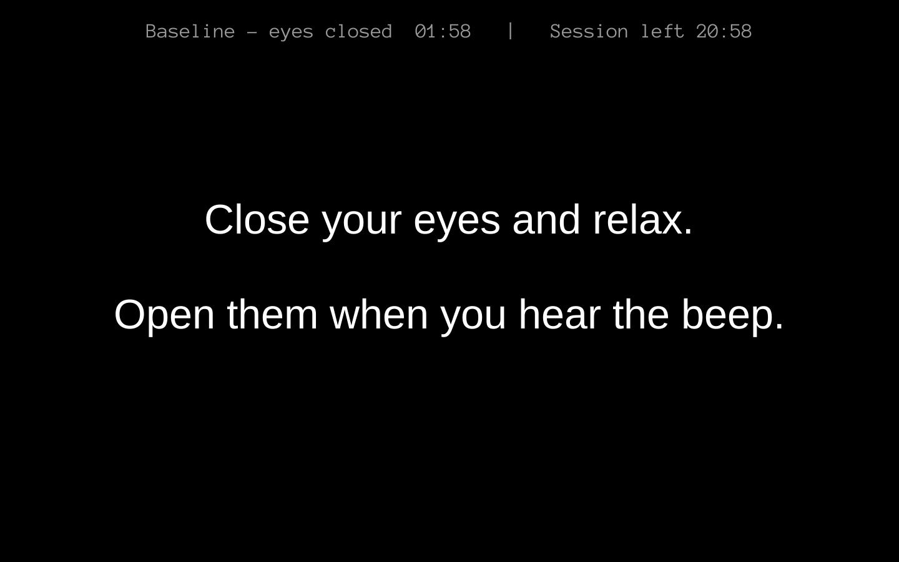
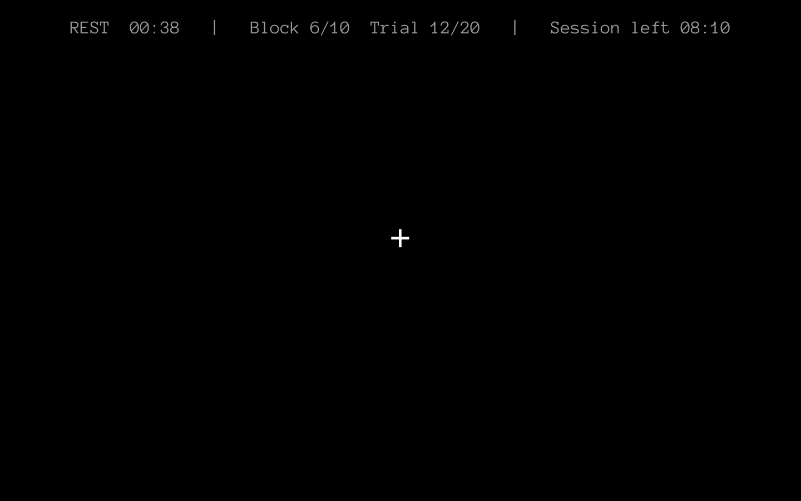
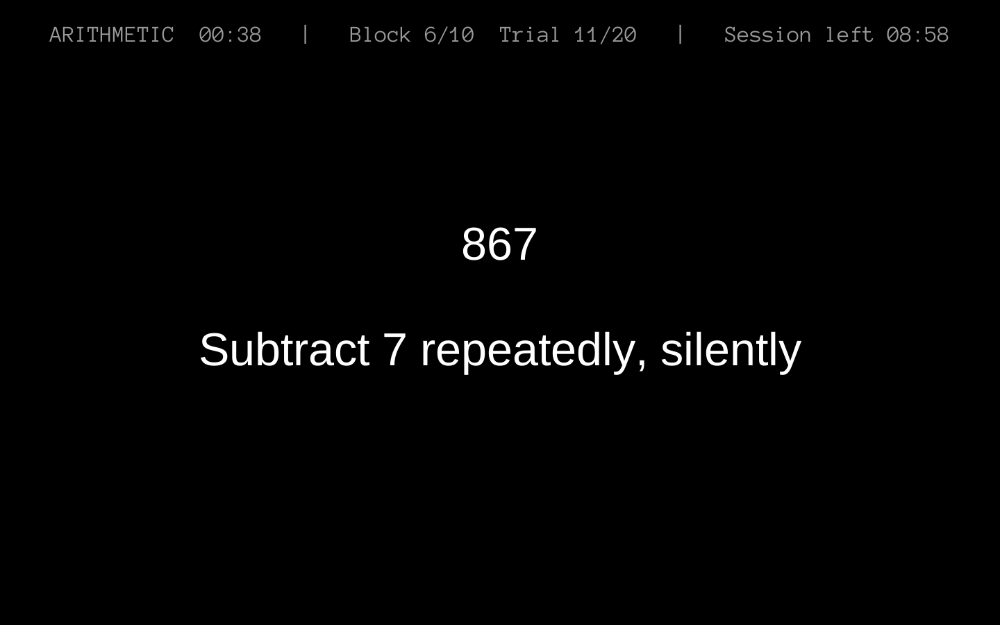
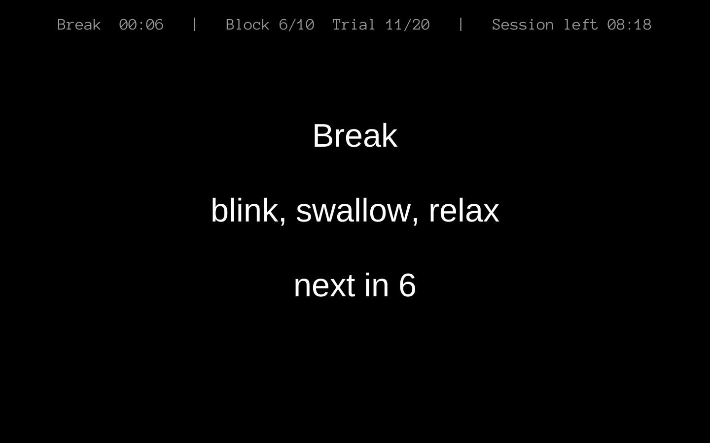

# Muse EEG Data Collection Dashboard

Recording software for a study classifying **rest vs mental arithmetic** from a 4-channel
Muse headband (TP9, AF7, AF8, TP10, reference Fpz, 256 Hz). Runs on macOS; the headband
streams over Bluetooth via `muselsl` and Lab Streaming Layer (LSL).

The goal is a subject-independent dataset: 60 participants × 2 sessions, collected at
Khulna University.

## Screenshots

| Signal quality: all channels good | Signal quality: TP10 has no contact |
|---|---|
|  |  |

| Baseline, eyes closed | Rest block |
|---|---|
|  |  |

| Arithmetic block | Break between blocks |
|---|---|
|  |  |

The top bar shows the current phase, its countdown, block/trial progress and total time left.
Screenshots were captured from `record_session.py` running against the simulated stream in
`tools/sim_muse.py`. More in [`docs/screenshots/`](docs/screenshots/).

## Quick start (Mac)

**First time:** install Python from python.org (it includes tkinter), then double-click
`0_Setup.command`. If macOS blocks it, right-click → Open → Open.

**Every session:**
1. Double-click `1_Start_Stream.command` and wait for `Streaming EEG...`. Leave it open.
2. Double-click `2_Record_Session.command` and enter the subject and session IDs.
3. Adjust the headband until all four channels read **GOOD**, then press **SPACE**.
4. Follow the screen (~21 min). **ESC** stops early and saves what was recorded.

`Start_Dashboard.command` launches the newer web dashboard (browser UI, live EEG, automatic
reconnect). Its code lives in `dashboard/` (see Roadmap).

## Session timeline (current version)

| Phase | Duration |
|---|---|
| Get ready | 5 s |
| Baseline, eyes closed (beep = open eyes) | 2 min |
| Baseline, eyes open (fixation cross) | 2 min |
| 10 × Rest + 10 × Arithmetic, 40 s each, random order within each pair, 8 s break after each | 16 min |
| Final baseline, eyes open | 1 min |

Arithmetic: a random 3-digit number appears; the participant subtracts 7 repeatedly, silently.

## Output

Each session is saved to `data/sub-XX/ses-YY/`:

- `eeg.csv`: `lsl_time, t_rel, TP9, AF7, AF8, TP10, Right AUX, label` (one row per sample, raw µV)
- `events.csv`: `onset, duration, trial_type, block, start_number`
- `session.json` (dashboard only): settings, sample count, measured sampling rate, gaps

`t_rel` and event onsets share the same zero. For the classifier use `label == rest` and
`label == arithmetic`; drop `break`.

`data/` is git-ignored. **Never commit participant recordings or consent forms.**

## Testing without the headband

```bash
python tools/sim_muse.py               # fake Muse stream, all channels good
python tools/sim_muse.py --dead-tp10   # same, with TP10 flat
python record_session.py --sub 99 --ses 01
```

## Analysis scripts

```bash
pip install -r analysis/requirements.txt
python analysis/analyze_session.py data/sub-01/ses-01          # single-session stats + classifier
python analysis/annotated_figures.py data/sub-01/ses-01        # annotated rest-vs-arithmetic figures
python analysis/compare.py data/sub-01/ses-01 data/sub-02/ses-01 --out out
python analysis/compare_figures.py                              # reads out/ from compare.py
```

They cover channel QC (spectral slope), 1–40 Hz filtering, band power, blink detection on TP9,
paired block-level statistics with FDR correction, and leave-one-block-pair-out classification
with permutation tests.

## Pilot findings (2 subjects)

1. **Eye blinks drove the "significant" results.** The Fpz reference sits on the forehead, so
   blinks show up as large negative dips on TP9. After removing blink segments, no band-power
   effect remained in either subject.
2. **TP10 had no skin contact in both recordings.** The current quality check (signal standard
   deviation only) did not catch it.
3. **AF8 was noisy in one subject** (forehead movement while calculating).

## Roadmap (protocol v2)

- [ ] Push the web dashboard code (`dashboard/`) from the recording Mac
- [ ] Signal-quality gate on spectral slope, 50 Hz noise and amplitude; recording locked until all 4 channels are good for 10 s
- [ ] 25 s blocks, 18 per class, 12 s breaks with a "BLINK NOW" cue
- [ ] Answer entry after arithmetic blocks; mind-wandering rating after rest blocks
- [ ] Voice cues (English / Bangla) for eyes-closed baselines and breaks only, never inside a task block
- [ ] Participant metadata form, live blink counter, automatic post-session QC report
