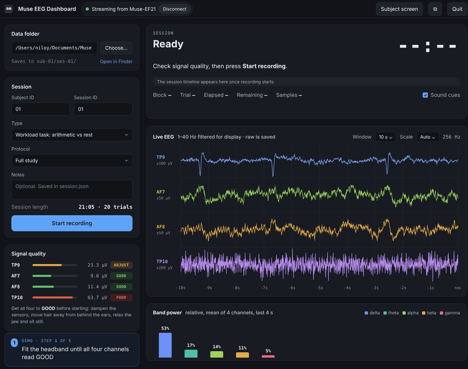
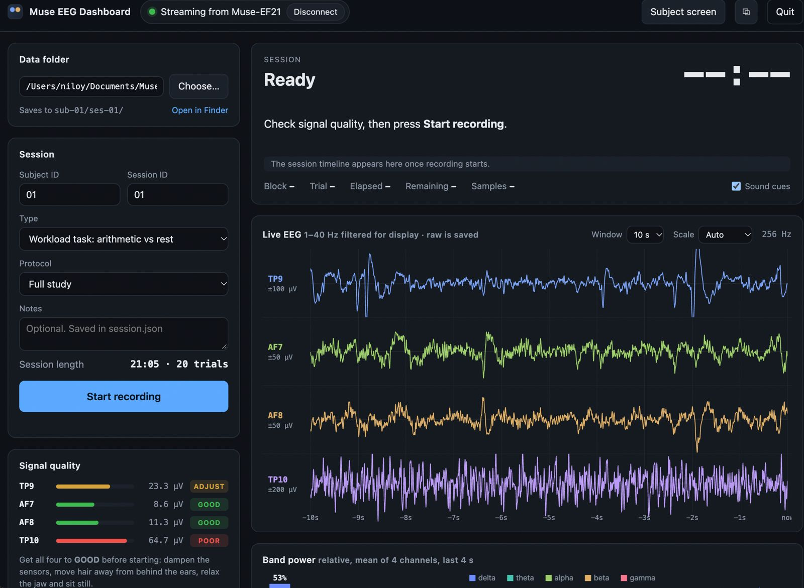
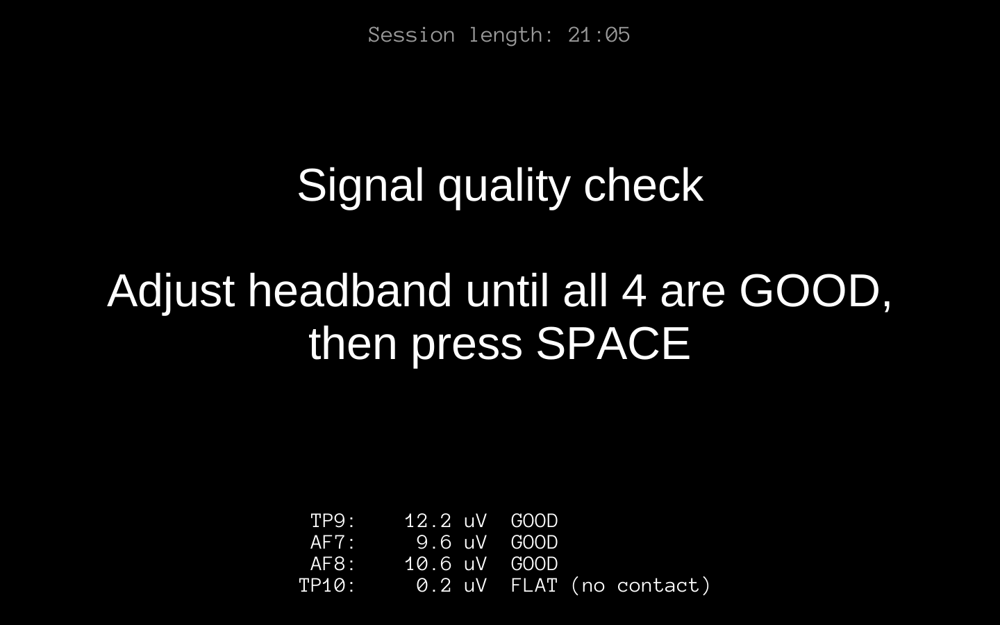

# Muse EEG Data Collection Dashboard

A Mac dashboard for recording EEG from a 4-channel **Muse headband** (TP9, AF7, AF8, TP10,
reference Fpz, 256 Hz) during a mental-workload task: **rest vs mental arithmetic**.
It checks signal quality, shows the participant what to do, labels every sample and saves
analysis-ready files.

The study it was built for is collecting a subject-independent dataset of 60 participants
× 2 sessions at Khulna University.



<sub>Demo animation: the dashboard interface recreated and driven by simulated EEG, showing one session
from signal check to saved files (time jumps ahead mid-session). Full-quality video:
[`docs/demo/dashboard_demo.mp4`](docs/demo/dashboard_demo.mp4).</sub>

## The dashboard



<sub>Real session, streaming from a Muse headband. TP10 reads POOR here; recording should only start
once all four channels are GOOD.</sub>

| Panel | What it does |
|---|---|
| **Data folder** | Choose where sessions go. Each one is saved to `<folder>/sub-XX/ses-YY/`. |
| **Session** | Subject ID, session ID (the next free one is filled in), type (*Workload task* or *Free recording*), protocol (*Full study* ~21 min, *Quick test* ~2 min, or *Custom*), notes. |
| **Signal quality** | Live amplitude per channel with GOOD / ADJUST / POOR, plus fitting tips. |
| **Session** (right) | Current phase, its countdown, a timeline of the whole protocol, block, trial, elapsed, remaining and sample count. Optional sound cues. |
| **Live EEG** | Scrolling 10 s view, 1–40 Hz filtered for display only. The raw signal is what's saved. |
| **Band power** | Relative delta, theta, alpha, beta and gamma power, averaged over the 4 channels, last 4 s. |
| **Subject screen** | Full-screen instructions and countdown for the participant. **⧉** opens it in its own window to drag onto a second monitor. |

The Mac is kept awake while the dashboard runs. If the Muse drops out mid-session the
dashboard reconnects automatically and lists the gap in `session.json`.

## Quick start (Mac)

1. Install Python from [python.org](https://www.python.org/downloads/macos/).
2. Turn the Muse on and make sure it is **not** connected to the Muse phone app.
3. Double-click **`Start_Dashboard.command`**. The first run sets up Python (about a minute),
   then the dashboard opens in a Chrome app window. If macOS asks for Bluetooth access for
   Terminal, click **Allow**. Keep the Terminal window open while recording.
4. Choose the data folder, enter the subject and session IDs.
5. Fit the headband until all four channels read **GOOD**, then press **Start recording**.

If macOS blocks a `.command` file ("unidentified developer"): right-click → **Open** → **Open**.

## Session timeline (Full study, 21:05)

| Phase | Duration |
|---|---|
| Get ready | 5 s |
| Baseline, eyes closed (sound cue = open eyes) | 2 min |
| Baseline, eyes open (fixation cross) | 2 min |
| 10 × Rest + 10 × Arithmetic, 40 s each, random order within each pair, 8 s break after each | 16 min |
| Final baseline, eyes open | 1 min |

**Rest:** look at the cross, mind calm. **Arithmetic:** a random 3-digit number appears and the
participant subtracts 7 repeatedly, silently.

## Output

`data/sub-XX/ses-YY/`

| File | Contents |
|---|---|
| `eeg.csv` | `lsl_time, t_rel, TP9, AF7, AF8, TP10, Right AUX, label`: one row per sample, raw µV |
| `events.csv` | `onset, duration, trial_type, block, start_number, status` |
| `session.json` | Settings, notes, sample count, measured sampling rate, gaps |

`t_rel` and event onsets share the same zero (session start). For the classifier use
`label == rest` and `label == arithmetic`; drop `break`.

> **Participant data never goes in this repository.** `data/`, `*.csv` and consent forms are
> git-ignored. Back recordings up to a private drive.

## Repository layout

```
Start_Dashboard.command    launches the web dashboard (code: dashboard/)
record_session.py          older Tk recorder, same protocol (see below)
record_raw.py              continuous raw recording, no task
0_Setup / 1_Start_Stream / 2_Record_Session.command   launchers for the Tk workflow
analysis/                  pilot analysis: QC, band power, blink detection, statistics, classifiers
tools/sim_muse.py          fake Muse LSL stream for testing without the headband
docs/                      screenshots and the demo animation
```

## Testing without the headband

```bash
python tools/sim_muse.py               # fake Muse stream, all channels good
python tools/sim_muse.py --dead-tp10   # same, with TP10 flat (no skin contact)
```

Then start the dashboard or `record_session.py` as usual.

## Analysis scripts

```bash
pip install -r analysis/requirements.txt
python analysis/analyze_session.py data/sub-01/ses-01        # single-session statistics + classifier
python analysis/annotated_figures.py data/sub-01/ses-01      # annotated rest-vs-arithmetic figures
python analysis/compare.py data/sub-01/ses-01 data/sub-02/ses-01 --out out
python analysis/compare_figures.py                            # reads out/ from compare.py
```

They cover channel QC (spectral slope), 1–40 Hz filtering, band power, blink detection on TP9,
paired block-level statistics with FDR correction, and leave-one-block-pair-out classification
with permutation tests.

## Pilot findings (2 subjects)

1. **Eye blinks drove the "significant" results.** The Fpz reference sits on the forehead, so
   blinks appear as large dips on TP9. After removing blink segments, no band-power effect
   remained in either subject.
2. **TP10 had no skin contact in both recordings**, and an amplitude-only quality check did not
   flag it.
3. **AF8 was noisy in one subject** (forehead movement while calculating).

## Roadmap (protocol v2)

- [ ] Push the web dashboard code (`dashboard/`) to this repository
- [ ] Signal-quality gate on spectral slope, 50 Hz noise and amplitude; recording locked until all 4 channels are GOOD for 10 s
- [ ] 25 s blocks, 18 per class, 12 s breaks with a "BLINK NOW" cue
- [ ] Answer entry after arithmetic blocks; mind-wandering rating after rest blocks
- [ ] Voice cues (English / Bangla) for eyes-closed baselines and breaks only, never inside a task block
- [ ] Participant metadata form, live blink counter, automatic post-session QC report

<details>
<summary><b>Legacy Tk recorder</b> (<code>record_session.py</code>)</summary>

The original full-screen recorder, kept as a fallback. It runs the same protocol and writes the
same `eeg.csv` / `events.csv`.

1. Double-click `0_Setup.command` once.
2. Each session: `1_Start_Stream.command` (wait for `Streaming EEG...`, leave it open), then
   `2_Record_Session.command` and enter the IDs.
3. Get all four channels to **GOOD**, press **SPACE**. **ESC** stops early and saves.

| Signal check, all good | Signal check, TP10 no contact |
|---|---|
|  |  |
| **Arithmetic block** | **Break** |
|  |  |

<sub>Captured from the recorder running against <code>tools/sim_muse.py</code>.</sub>

**Troubleshooting:** no Muse found → turn it off and on, close the Muse phone app, check
Bluetooth. Several Muse nearby → edit `1_Start_Stream.command` to
`muselsl stream --name Muse-EF21`. "LSL binary library file was not found" →
`brew install labstreaminglayer/tap/lsl`.

</details>
